# Laporan Proyek Machine Learning - Fatmah Fianka Syafrudin

## Domain Proyek

Diabetes mellitus merupakan salah satu penyakit kronis dengan prevalensi yang terus meningkat secara global. Menurut IDF Diabetes Atlas 2025, sekitar 589 juta orang dewasa (usia 20–79 tahun) hidup dengan diabetes pada tahun 2024, dan angka ini diperkirakan akan meningkat menjadi 853 juta pada tahun 2050 [[1](https://diabetesatlas.org/)]. Di Indonesia, peningkatan kasus juga terjadi akibat gaya hidup tidak sehat, kurang aktivitas fisik, dan pola makan buruk.

Deteksi dini sangat penting karena banyak penderita baru menyadari kondisinya saat sudah mengalami komplikasi. Namun, metode konvensional diagnosis sering membutuhkan waktu dan biaya besar. Dalam konteks ini, machine learning hadir sebagai solusi yang efisien dan akurat untuk memprediksi risiko diabetes dengan menganalisis data kesehatan pasien seperti kadar glukosa, tekanan darah, BMI, usia, dan lainnya.

Proyek ini menggunakan dataset Healthcare Diabetes dari Kaggle untuk membangun model prediksi risiko diabetes. M. Hasan & F. Yasmin. (2025) menunjukkan bahwa model berbasis deep learning dapat mencapai akurasi hingga 99,79% dalam prediksi diabetes [[2](https://arxiv.org/abs/2505.07036)]. Dengan demikian, penerapan machine learning tidak hanya mempercepat deteksi dini, tetapi juga mendukung pengambilan keputusan medis secara digital dan tepat sasaran.

## Business Understanding

### Problem Statements

- Bagaimana mempersiapkan data secara efektif sebelum digunakan dalam proses pelatihan model machine learning?
- Fitur data kesehatan apa saja yang paling berpengaruh terhadap risiko diabetes?
- Bagaimana membangun model machine learning yang efektif dan dapat diinterpretasikan oleh tenaga medis?

### Goals

- Menerapkan tahapan pra-pemrosesan data yang efektif, seperti _data cleaning_, penanganan _missing value_, dan normalisasi untuk memastikan kualitas data yang optimal dalam pelatihan model.
- Mengidentifikasi fitur-fitur kunci yang berkontribusi besar terhadap risiko diabetes.
- Membuat model yang efisien dan scalable agar dapat digunakan untuk analisis risiko pada populasi yang lebih luas.

### Solution statements

Untuk mencapai tujuan memprediksi risiko diabetes secara akurat dan efisien, proyek ini akan mengimplementasikan beberapa solusi sebagai berikut:

- Melakukan pra-pemrosesan dan _feature selection_ untuk memilih fitur yang paling berkontribusi dalam prediksi, guna meningkatkan efisiensi dan akurasi model.
- Menggunakan tiga algoritma machine learning: _Logistic Regression_, _K-Nearest Neighbors_ (KNN), dan _Support Vector Machine_ (SVM) untuk membangun model prediksi.

## Data Understanding

Dataset yang digunakan dalam proyek ini berasal dari [Healthcare Diabetes](https://www.kaggle.com/datasets/nanditapore/healthcare-diabetes) yang tersedia di platform Kaggle. Dataset ini terdiri dari 2768 baris dan 10 kolom. Dataset ini berisi data kesehatan individu yang bertujuan untuk memprediksi risiko diabetes berdasarkan berbagai fitur medis dan demografis.

### Variabel-variabel pada dataset adalah sebagai berikut:

- Id : Nomor identifikasi unik untuk setiap individu dalam dataset.
- Pregnancies : Jumlah kehamilan yang pernah dialami pasien.
- Glucose : Tingkat glukosa darah 2 jam setelah tes toleransi glukosa oral.
- BloodPressure : Tekanan darah diastolik (mm Hg).
- SkinThickness : Ketebalan lipatan kulit trisep (mm).
- Insulin : Tingkat insulin serum 2 jam setelah tes toleransi glukosa oral (mu U/ml).
- BMI : Indeks massa tubuh (berat badan dalam kg dibagi kuadrat tinggi badan dalam meter).
- DiabetesPedigreeFunction : Fungsi silsilah diabetes yang mengukur kemungkinan risiko diabetes berdasarkan riwayat keluarga.
- Age : Usia pasien dalam tahun.
- Outcome : Kelas target yang menunjukkan apakah pasien mengidap diabetes (1) atau tidak (0).

### Exploratory Data Analysis (EDA)

- Menganalisis Outlier  
  Fitur-fitur yang digunakan sebagai indikator dalam menentukan risiko diabetes, seperti Pregnancies, Glucose, BloodPressure, SkinThickness, Insulin, BMI, DiabetesPedigreeFunction, dan Age, akan dianalisis dari segi distribusinya untuk memahami sebaran nilai serta mengidentifikasi kemungkinan adanya outlier dalam data.
  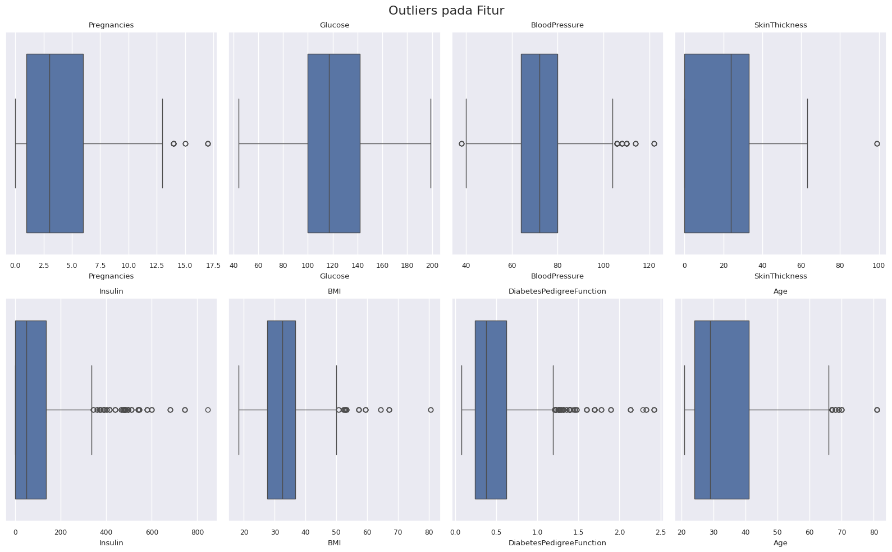  
  **Gambar 1**

  Terlihat bahwa seluruh fitur mengandung outlier. Outlier merupakan nilai yang menyimpang secara signifikan dari sebagian besar nilai pada fitur tersebut. Nilai nol yang muncul pada fitur seperti Glucose, BloodPressure, dan BMI dianggap sebagai anomali karena secara medis nilai tersebut tidak realistis. Selain itu, fitur Insulin dan DiabetesPedigreeFunction menunjukkan jumlah outlier yang paling banyak dibandingkan fitur lainnya.

- Menganalisis Distribusi Data
  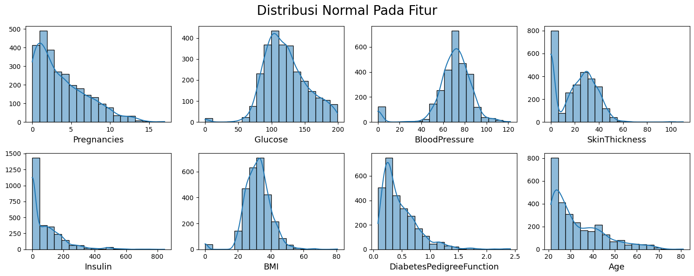
  **Gambar 2**

  Sebagian besar fitur menunjukkan distribusi yang tidak normal. Hanya Glucose dan BloodPressure yang tampak mendekati distribusi normal, meskipun keduanya mengandung nilai outlier berupa angka 0. Sementara itu, fitur-fitur lainnya cenderung memiliki distribusi miring ke kanan (right-skewed). Nilai 0 pada fitur Glucose dan BloodPressure akan dihapus karena dianggap sebagai anomali yang tidak sesuai dengan kondisi sebenarnya.

- Keseimbangan Kelas dalam Dataset  
  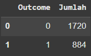  
  **Gambar 3**  
  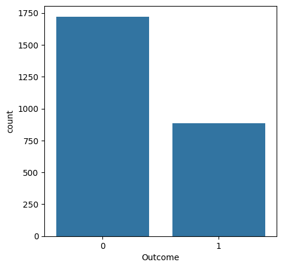  
   **Gambar 4**

  Data klasifikasi biner pada fitur Outcome menunjukkan ketidakseimbangan, di mana jumlah sampel dengan kategori tidak mengidap diabetes (0) hampir dua kali lebih banyak dibandingkan dengan sampel yang mengidap diabetes (1).

- Hubungan antar Fitur  
  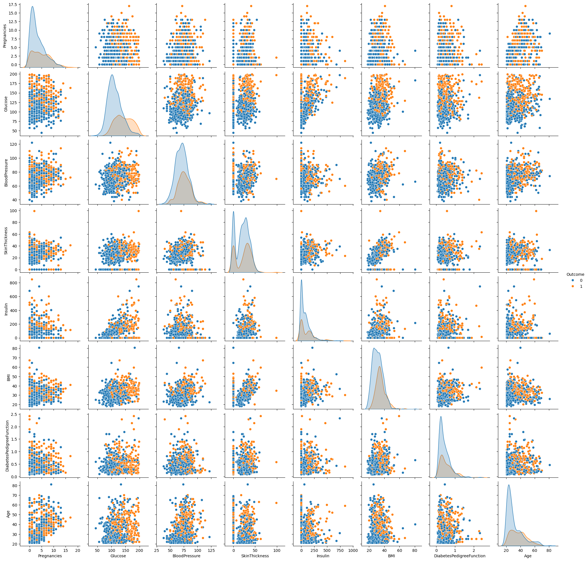  
  **Gambar 5**

  Pairplot tidak menunjukkan adanya informasi yang signifikan untuk mengidentifikasi hubungan antar fitur, baik yang bersifat positif maupun negatif.

- Korelasi antar Fitur  
  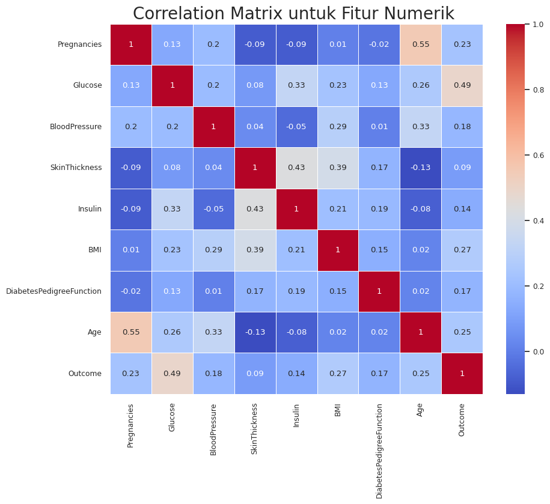
  **Gambar 6**

  Matriks korelasi mengindikasikan adanya hubungan antar fitur yang terdapat dalam dataset. Fitur Glucose (0,49), BMI (0,27), Age (0,25), dan Pregnancies (0,23) menunjukkan korelasi yang lebih kuat terhadap variabel Outcome, yang merupakan indikator keberadaan diabetes, dibandingkan fitur lainnya. Sementara itu, fitur BloodPressure (0,18), DiabetesPedigreeFunction (0,17), dan Insulin (0,14) juga memiliki korelasi dengan Outcome, meskipun dengan nilai yang lebih rendah. Terdapat pula beberapa pasangan fitur yang memiliki korelasi tinggi satu sama lain namun korelasinya terhadap Outcome relatif rendah, seperti antara Age dan Pregnancies (0,55), Insulin dan SkinThickness (0,43), BMI dan SkinThickness (0,39), Age dan BloodPressure (0,33), serta Glucose dan Insulin (0,33), dan lain-lain.

  Karena model yang dibangun bertujuan memprediksi Outcome sebagai indikator adanya diabetes atau tidak, maka hanya fitur-fitur dengan korelasi signifikan terhadap Outcome, yaitu Pregnancies, Glucose, BMI, dan Age yang akan dipilih sebagai variabel utama dalam proses prediksi. Fitur-fitur ini akan dianalisis lebih mendalam untuk meningkatkan performa model.

- Hubungan Outcome dengan Fitur Berpengaruh
  - Glucose dengan Outcome
    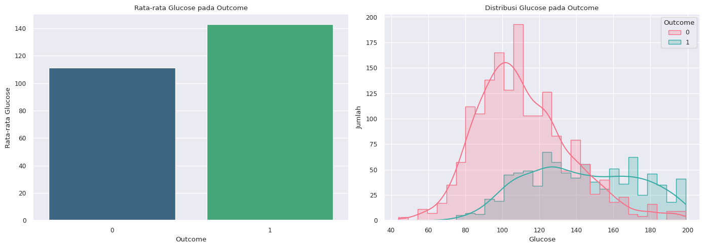  
    **Gambar 7**
  - BMI dengan Outcome
    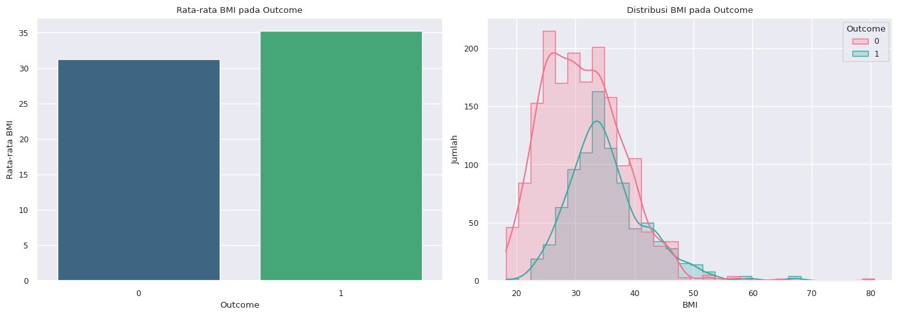  
    **Gambar 8**
  - Age dengan Outcome  
    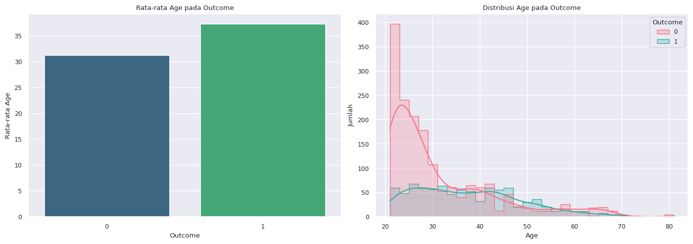  
    **Gambar 9**
  - Age dengan Outcome  
    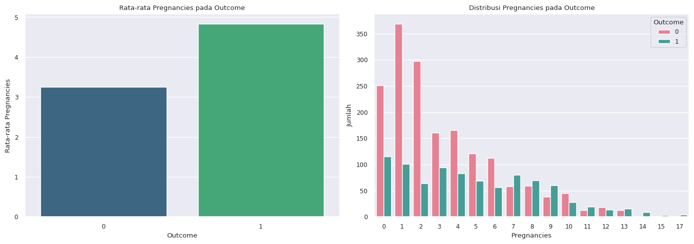  
    **Gambar 10**  
    Pada Gambar 6 hingga Gambar 10, terlihat bahwa nilai rata-rata pada keempat fitur tersebut cenderung lebih tinggi pada individu yang mengidap diabetes dibandingkan dengan mereka yang tidak mengidap diabetes.

## Data Preparation

1. **Menghapus Kolom yang Tidak Relevan**
   Menghapus kolom Id karena kolom ini hanya berfungsi sebagai identifikasi dan tidak memiliki pengaruh dalam proses prediksi.
2. **Menghapus Data Anomali**  
   Beberapa fitur seperti Glucose, BloodPressure, dan BMI memiliki nilai 0 yang secara medis tidak mungkin terjadi, sehingga dianggap sebagai anomali. Nilai-nilai tersebut dihapus untuk meningkatkan kualitas data dan menghindari distorsi pada hasil pelatihan model.
3. **Pemilihan Fitur (Feature Selection)**
   Untuk menyederhanakan model dan meningkatkan efisiensi, dilakukan pemilihan fitur berdasarkan korelasi terhadap label Outcome. Ada 5 fitur yang dipilih yaitu : Pregnancies, Glucose, BMI, Age, dan Outcome
4. **Memisahkan Fitur dan Label**  
   Data dipisahkan menjadi dua bagian, yaitu fitur X (Pregnancies, Glucose, BMI, dan Age) dan label Y (Outcome). Pemisahan ini diperlukan agar model dapat dilatih hanya berdasarkan informasi yang relevan sebagai input.
5. **Membagi Data Menjadi Training dan Testing Set**  
   Dataset dibagi dengan rasio 80% data untuk pelatihan (training set) dan 20% untuk pengujian (testing set). Pembagian ini bertujuan untuk menguji performa model pada data yang belum pernah dilihat sebelumnya, guna menghindari overfitting
6. **Standarisasi Fitur**  
   Fitur-fitur numerik dinormalisasi menggunakan StandardScaler agar memiliki distribusi dengan mean 0 dan standar deviasi 1. Proses ini penting karena algoritma seperti SVM dan KNN sangat sensitif terhadap skala data, dan standarisasi memastikan semua fitur memiliki pengaruh yang seimbang dalam proses pelatihan model.

## Modeling

Pada tahap pemodelan ini, menggunakan tiga algoritma machine learning untuk menyelesaikan permasalahan klasifikasi: Logistic Regression, K-Nearest Neighbors (KNN), dan Support Vector Machine (SVM). Berikut penjelasan mengenai tahapan, kelebihan dan kekurangan masing-masing algoritma, serta proses improvement hyperparameter tuning.

### Logistic Regression

Logistic Regression adalah algoritma klasifikasi yang digunakan untuk memprediksi probabilitas kejadian suatu peristiwa. Model ini menggunakan fungsi sigmoid untuk memetakan input numerik menjadi nilai probabilitas antara 0 dan 1. Meskipun disebut "regression," algoritma ini digunakan untuk tugas klasifikasi biner dan dapat diperluas ke klasifikasi multikelas.

**Kelebihan:**

- Sederhana dan cepat: Mudah diimplementasikan dan efisien untuk pelatihan pada dataset besar.
- Interpretasi yang jelas: Koefisien model dapat diinterpretasikan sebagai indikasi pentingnya fitur.
- Output probabilistik: Memberikan probabilitas kelas, bukan hanya label kelas.
- Tidak rentan terhadap overfitting: Terutama ketika jumlah fitur lebih kecil dibandingkan jumlah observasi.

**Kekurangan:**

- Asumsi linearitas: Mengasumsikan hubungan linear antara fitur dan log odds, yang mungkin tidak sesuai untuk semua data.
- Tidak cocok untuk data non-linear: Kinerja menurun jika data tidak dapat dipisahkan secara linear.
- Sensitif terhadap outlier: Outlier dapat mempengaruhi estimasi parameter model.
- Memerlukan data bebas multikolinearitas: Kehadiran multikolinearitas dapat mempengaruhi stabilitas koefisien.

**Classification Report**  
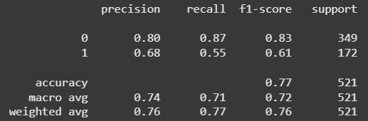  
Akurasi model sebesar 0.77

**Hyperparameter Tuning**

Pada Logistic Regression, improvement dilakukan dengan menerapkan _Grid Search Cross-Validation_ untuk mencari kombinasi hyperparameter terbaik antara kekuatan regularisasi (C) dan pilihan solver. Dengan menyiapkan grid parameter C dalam rentang $0.001, 0.01, 0.1, 1, 10$ dan opsi solver ['liblinear', 'newton-cg', 'lbfgs', 'sag', 'saga']. Dengan GridSearchCV 5-fold, tiap kombinasi diuji secara sistematis, kemudian dipilih model dengan akurasi rata-rata validasi tertinggi. Hasilnya, ditemukan C=0.01 dan solver='newton-cg' sebagai konfigurasi optimal, yang berhasil meningkatkan akurasi pada data uji dibandingkan model default.  
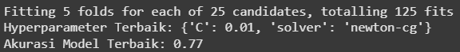  
Setelah melakukan hyperparameter tuning, akurasi model tidak berubah yaitu tetap 0.77

### K-Nearest Neighbors (KNN)

KNN adalah algoritma non-parametrik yang digunakan untuk klasifikasi dan regresi. Model ini menentukan kelas atau nilai dari suatu data baru berdasarkan mayoritas kelas atau rata-rata nilai dari 'k' tetangga terdekatnya dalam ruang fitur.

**Kelebihan:**

- Sederhana dan intuitif: Mudah dipahami dan diimplementasikan.
- Tidak memerlukan pelatihan: Model langsung menggunakan data pelatihan saat prediksi.
- Fleksibel: Dapat digunakan untuk klasifikasi dan regresi.
- Non-parametrik: Tidak mengasumsikan distribusi data tertentu.

**Kekurangan:**

- Komputasi lambat pada dataset besar: Waktu prediksi meningkat seiring ukuran data karena perhitungan jarak ke semua titik data.
- Sensitif terhadap skala fitur: Fitur dengan skala lebih besar dapat mendominasi perhitungan jarak.
- Kurang efektif pada data berdimensi tinggi: Kinerja menurun karena 'curse of dimensionality'.
- Memerlukan pemilihan nilai 'k' yang optimal: Nilai 'k' yang tidak tepat dapat mempengaruhi akurasi model.

**Classification Report**

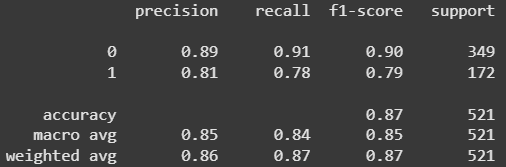  
Akurasi model sebesar 0.87

**Hyperparameter Tuning**

Pada KNN, peningkatan performa didapatkan melalui Elbow Method, yaitu menilai error rate (proporsi prediksi salah) pada nilai $k$ yang berbeda–beda. Dengan menghitung error rate untuk $k$=1 hingga 7, kemudian memplot kurva error rate terhadap nilai $k$. Titik “siku” (elbow) pada grafik di mana penurunan error rate mulai melambat dipilih sebagai $k$ optimal, yaitu $k=2$. Meskipun nilai error terkecil ditemukan pada $k$=1 dengan error rate 0.0, pemilihan $k$=1 sering kali terlalu sensitif terhadap noise dan berisiko menyebabkan overfitting karena hanya mempertimbangkan satu tetangga terdekat. Oleh karena itu, untuk menghindari kompleksitas model yang berlebihan dan meningkatkan generalisasi, dipilih $k$=2. Model awal dibangun dengan parameter default, yaitu n_neighbors=5. Model kemudian di-retrain dengan n_neighbors=2, yang terbukti memberikan akurasi lebih tinggi daripada $k$=5 default, tanpa perlu melakukan pencarian grid yang ekstensif.
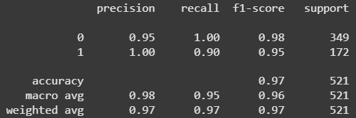  
Setelah melakukan hyperparameter tuning, akurasi model berubah menjadi 0.97

### Support Vector Machine (SVM)

SVM adalah algoritma klasifikasi yang mencari hyperplane optimal yang memisahkan kelas-kelas dalam ruang fitur. Dengan menggunakan kernel trick, SVM dapat menangani data yang tidak dapat dipisahkan secara linear dengan memetakan data ke ruang berdimensi lebih tinggi.

**Kelebihan:**

- Efektif pada data berdimensi tinggi: Kinerja baik meskipun jumlah fitur melebihi jumlah sampel.
- Kemampuan menangani data non-linear: Dengan kernel trick, SVM dapat memisahkan data yang tidak linear.
- Robust terhadap overfitting: Terutama pada dataset dengan margin yang jelas antara kelas.
- Efisien dalam penggunaan memori: Hanya menggunakan subset data (support vectors) untuk membuat keputusan.

**Kekurangan:**

- Komputasi intensif pada dataset besar: Waktu pelatihan meningkat secara signifikan dengan ukuran data.
- Sensitif terhadap pemilihan kernel dan parameter: Pemilihan kernel yang tidak tepat dapat menurunkan kinerja model.
- Tidak memberikan probabilitas secara langsung: Memerlukan metode tambahan untuk estimasi probabilitas.
- Kurang efektif pada data dengan noise tinggi atau kelas yang tumpang tindih: Kinerja menurun jika data tidak dapat dipisahkan dengan margin yang jelas.

**Classification Report**

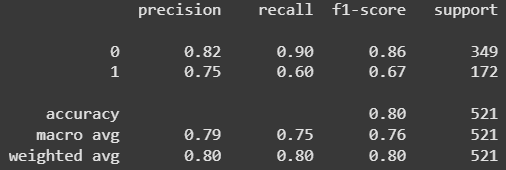  
Akurasi model sebesar 0.80

**Hyperparameter Tuning**

Pada SVM, improvement juga menggunakan _Grid Search Cross-Validation_ untuk menyesuaikan parameter C (regularisasi) dan gamma (skala kernel RBF). Grid parameter mencakup C $0.1, 1, 10, 100, 1000$ dan gamma $1, 0.1, 0.01, 0.001, 0.0001$, dengan kernel tetap rbf. Dalam setiap iterasi 5-fold, kombinasi diuji dan model dengan akurasi validasi tertinggi dipilih. Konfigurasi terbaik C=1000 dan gamma=1 kemudian di-retrain dan menghasilkan peningkatan akurasi pada data uji, menunjukkan bahwa tuning kedua parameter tersebut efektif dalam memperbesar margin pemisah dan meminimalkan kesalahan klasifikasi.

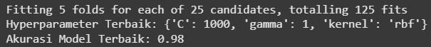

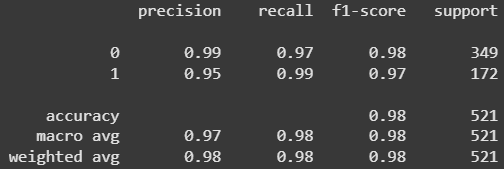  
Setelah melakukan hyperparameter tuning, akurasi model berubah menjadi 0.98

## Evaluation

Proyek ini mengimplementasikan model klasifikasi biner yang dievaluasi menggunakan metrik F1-score, akurasi, presisi, dan recall. Metrik-metrik ini diturunkan dari Confusion Matrix, sebuah tabel yang berfungsi mengukur kinerja model dengan membandingkan hasil prediksi dengan kondisi data sesungguhnya. Dari tabel tersebut, dihasilkan empat nilai penting.

|                    | **Keadaan Data Sebenarnya**                          |                                                                       |
| ------------------ | ---------------------------------------------------- | --------------------------------------------------------------------- |
|                    | **TRUE**                                             | **FALSE**                                                             |
| **Hasil Prediksi** | TP (True Positive) disebut juga _correct result_  | FP (False Positive) disebut juga _unexpected result_/_false alarm_ |
|                    | FN (False Negative) disebut juga _missing result_ | TN (True Negative) disebut juga _correct rejection_                |

- Akurasi (Accuracy)  
   Mengukur proporsi prediksi yang benar terhadap seluruh prediksi.  
  Formula:  
  $$ \text{Accuracy} = \frac{\text{TP} + \text{TN}}{\text{TP} + \text{TN} + \text{FP} + \text{FN}} $$

- Presisi (Precision)  
  Mengukur proporsi prediksi positif yang benar-benar positif.  
  Formula:
  $$ \text{Precision} = \frac{\text{TP}}{\text{TP} + \text{FP}} $$

- Recall (Sensitivity)  
  Mengukur proporsi kasus positif yang berhasil terdeteksi oleh model.  
  Formula:  
  $$ \text{Precision} = \frac{\text{TP}}{\text{TP} + \text{FN}} $$

- F1 Score  
  Merupakan rata-rata harmonik dari presisi dan recall, memberikan keseimbangan antara keduanya.  
  Formula:  
  $$ \text{F1 Score} = 2 \times \frac{\text{Precision} \times \text{Recall}}{\text{Precision} + \text{Recall}} $$

Dapat dilihat Confusion Matrix dari ketiga model seperti di bawah ini.  
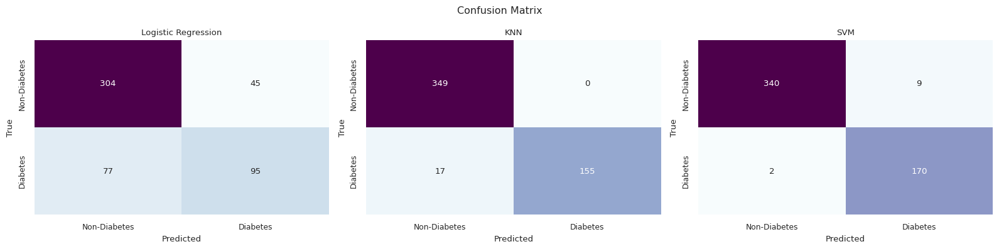

- SVM menunjukkan performa tertinggi dengan akurasi 97%, didukung oleh nilai FN (False Negative) yang sangat rendah (hanya 2 kasus), yang berarti model ini sangat baik dalam mendeteksi pasien diabetes.

- KNN menghasilkan recall tinggi (0.90) dan presisi sempurna (1.00), namun tampak overfitting karena tidak memprediksi satu pun kasus negatif sebagai positif.

- Logistic Regression memberikan performa moderat dan seimbang, namun FN yang cukup tinggi (77 kasus) mengindikasikan banyak pasien diabetes tidak terdeteksi.

Berdasarkan analisis performa dari ketiga model yang diuji, mencakup nilai accuracy, precision, recall, F1-score. Maka, diperoleh informasi berikut:

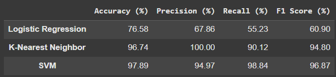

Perbandingan ketiga algoritma KNN, SVM, dan Regresi Logistik dilakukan berdasarkan nilai accuracy, precision, recall, F1-score. Hasil menunjukkan bahwa KNN dan SVM menjadi yang terbaik dengan performa dengan Accuracy 96.7% dan F1-score 94.8% untuk KNN dan Accuracy 97.8% dan F1-score 96.8% untuk SVM. Sementara itu, Regresi Logistik memberikan hasil yang kurang memuaskan, dengan Accuracy 76% dan F1-score 60,9%.

## Kesimpulan

Dapat disimpulkan dari penelitian ini bahwa model yang dibangun menggunakan algoritma K-Nearest Neighbor (KNN) dan Support Vector Machine (SVM) memberikan performa yang sangat baik, diukur dari akurasi, presisi, recall, dan F1-score. Meskipun ketiga algoritma ini (bersama Logistic Regression) menjadi objek perbandingan, Logistic Regression menghasilkan kinerja yang paling rendah.

## Refrensi

[1] International Diabetes Federation, IDF Diabetes Atlas, 11th ed., Brussels, Belgium: IDF, 2025. [Online]. Available: https://diabetesatlas.org/

[2] M. Hasan and F. Yasmin, “Predicting Diabetes Using Machine Learning: A Comparative Study of Classifiers,” arXiv preprint arXiv:2505.07036, May 2025. [Online]. Available: https://arxiv.org/abs/2505.07036
